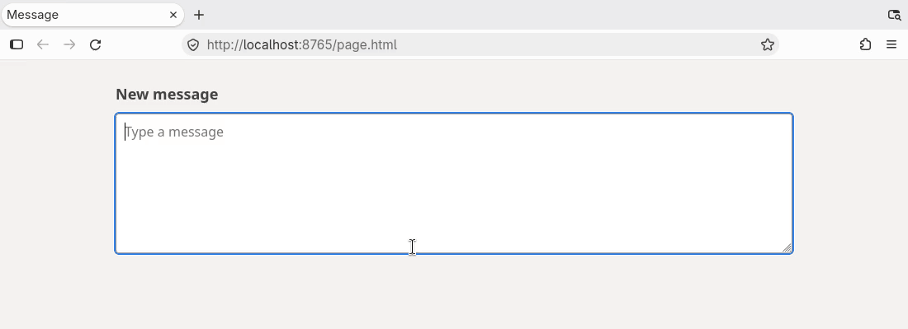

# typeclip

Types your clipboard out as keystrokes after a few seconds. For pages with a broken paste, like teams.cloud.microsoft.



The demo page blocks pasting on purpose.

## Install

Needs bash, xclip, xdotool and dmenu on X11. Notifications go through `dunstify` when it's there.

```sh
cp typeclip ~/.local/bin/
```

## Usage

Copy the text, run `typeclip` from dmenu or a terminal, then click into the field. It types after 3 seconds.

```sh
typeclip                  # type the clipboard
typeclip -d 5             # wait 5 seconds first
typeclip "some text"      # type this instead of the clipboard
```

Set `TYPECLIP_DELAY` to change the default. Newlines are typed as Return, so a multi-line text lands the way it was copied, which can send a chat message early.

## Notes

Typing is about 80 characters a second, so a long text takes a moment. Don't touch the keyboard until it's done.
